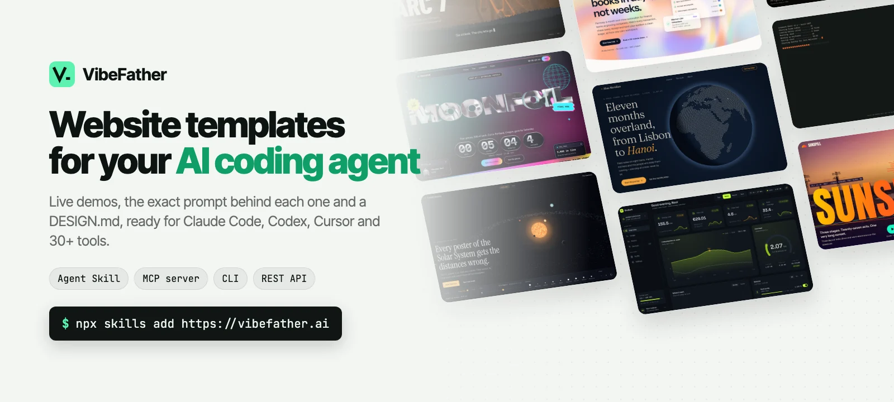
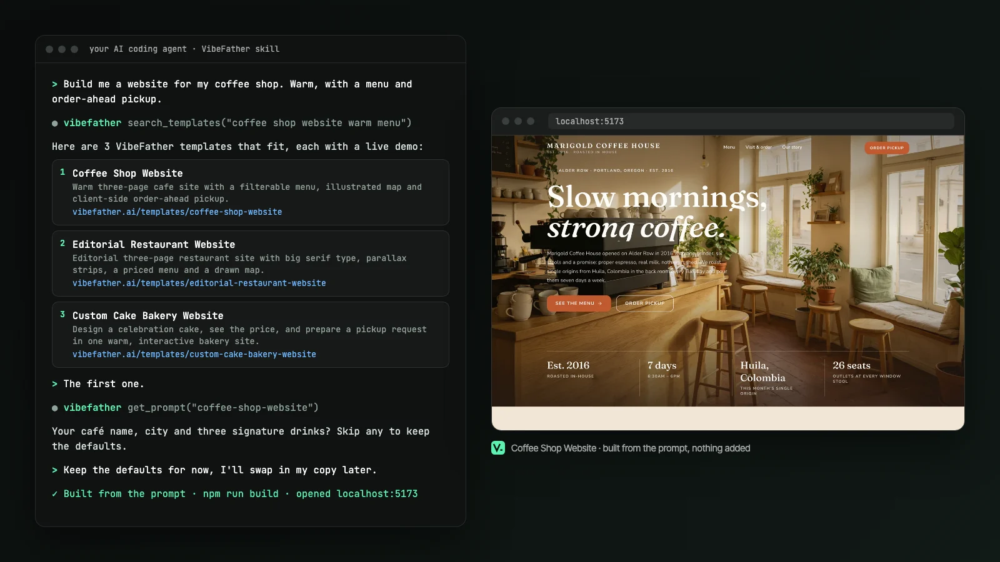
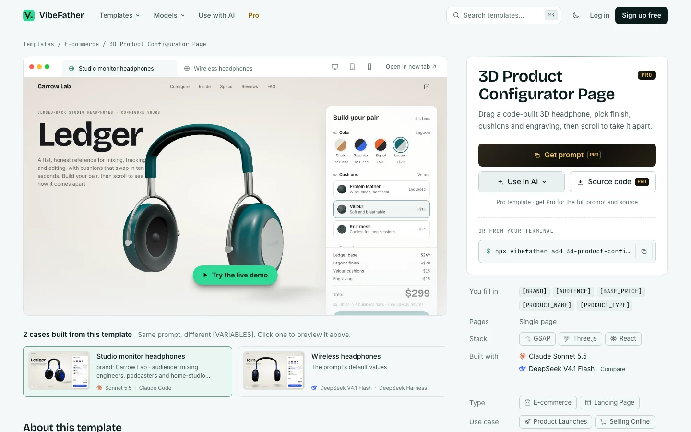
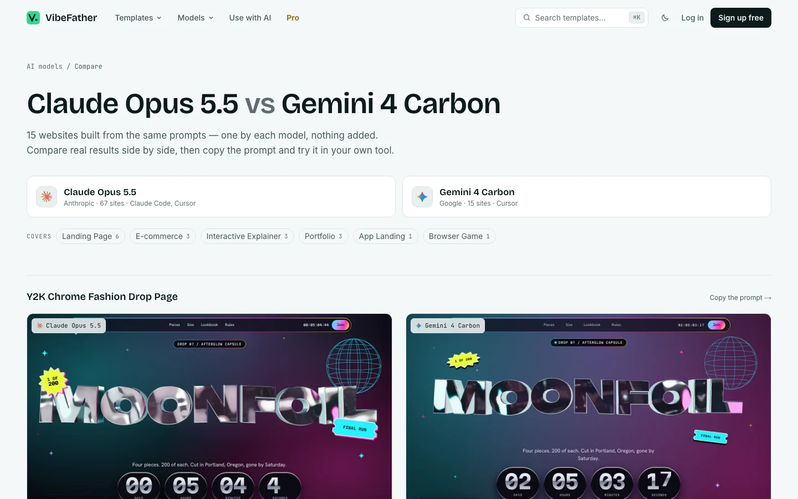
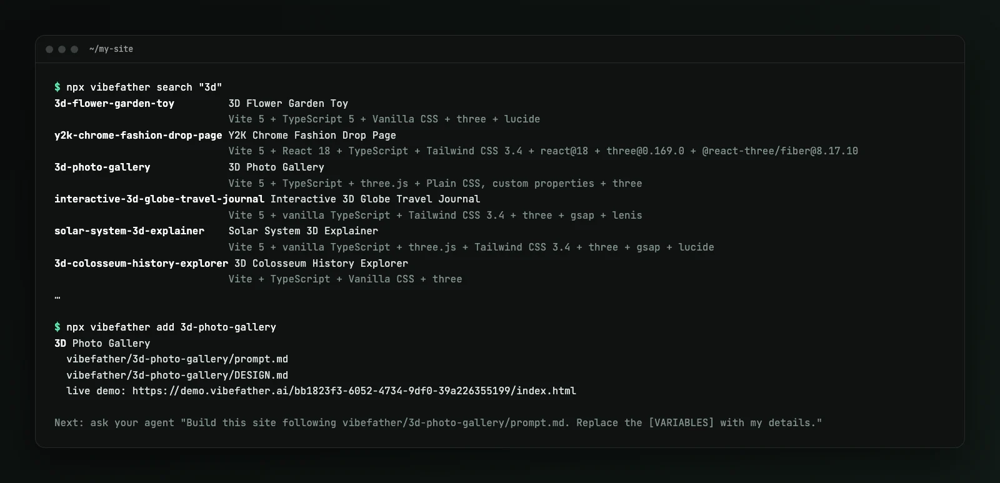
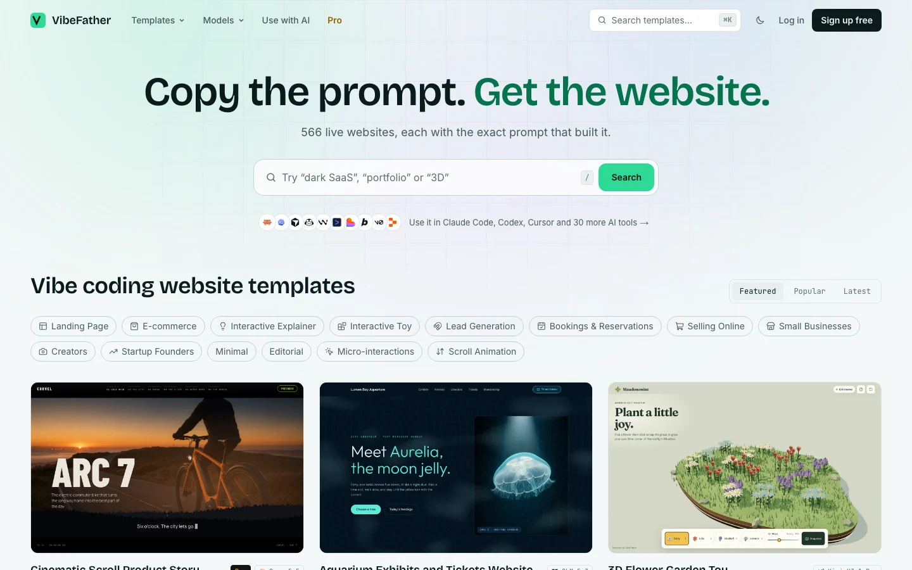
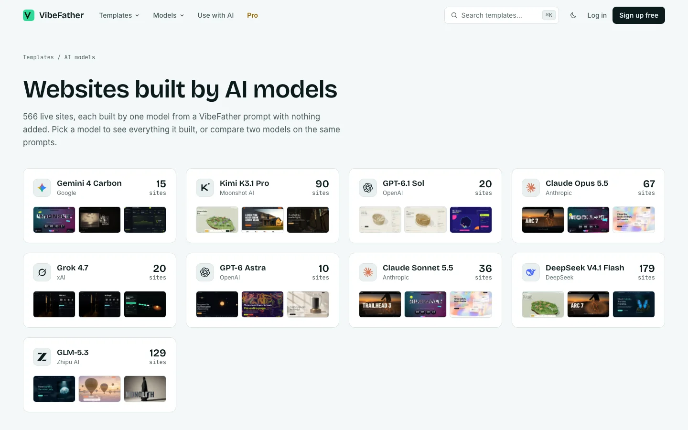
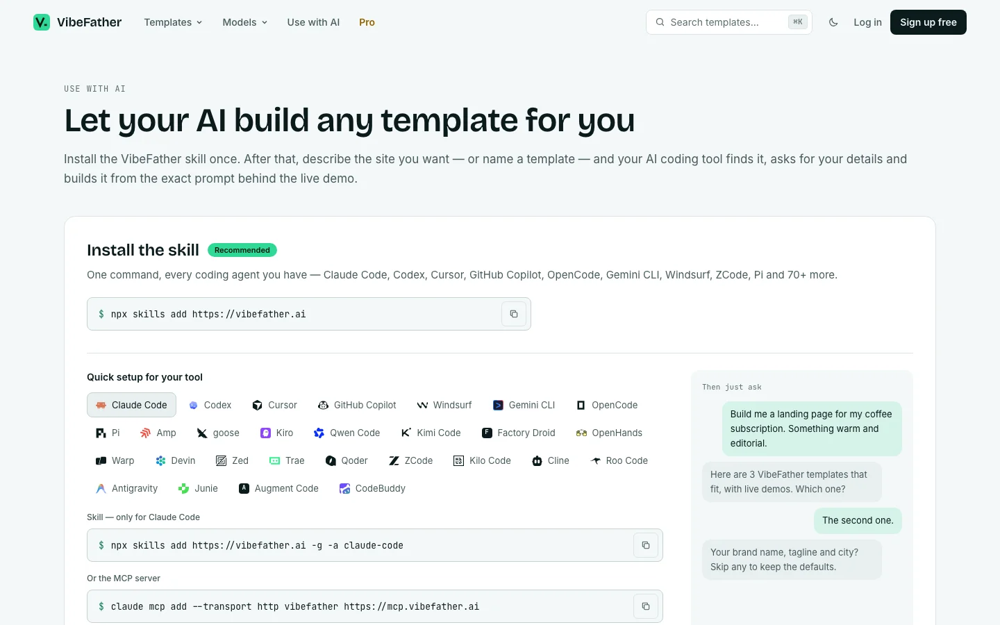

<!-- Generated by the VibeFather sync script. Edit the source, not this file. -->
<p align="center">
  <a href="https://vibefather.ai/?utm_source=github&utm_medium=readme&utm_campaign=vibefather&utm_content=hero">
    <picture>
      <source media="(prefers-color-scheme: dark)" srcset="assets/hero-dark.webp">
      
    </picture>
  </a>
</p>

<h1 align="center">VibeFather</h1>

<p align="center">
  <b>Vibe coding website templates for AI coding agents: an Agent Skill, a remote MCP server and a CLI.</b><br>
  Give Claude Code, Codex, Cursor, GitHub Copilot or Gemini CLI <!-- T -->320+<!-- /T --> original website templates with live demos.<br>
  Describe the site you want. Your agent picks a template, asks for your details once, and builds it from the exact prompt behind the demo.
</p>

<p align="center">
  <a href="https://vibefather.ai/?utm_source=github&utm_medium=readme&utm_campaign=vibefather&utm_content=badge"></a>
  <a href="https://vibefather.ai/templates?utm_source=github&utm_medium=readme&utm_campaign=vibefather&utm_content=badge"></a>
  <a href="https://vibefather.ai/templates?utm_source=github&utm_medium=readme&utm_campaign=vibefather&utm_content=badge"></a>
  <a href="https://vibefather.ai/models?utm_source=github&utm_medium=readme&utm_campaign=vibefather&utm_content=badge"></a>
  <a href="#mcp-server"></a>
  <a href="#agent-skill"></a>
  <a href="https://www.npmjs.com/package/vibefather"></a>
  <a href="LICENSE"></a>
</p>

<p align="center">
  <a href="https://vibefather.ai/?utm_source=github&utm_medium=readme&utm_campaign=vibefather&utm_content=top-cta"><b>▶ Browse <!-- S -->700+<!-- /S --> live demos</b></a> &nbsp;·&nbsp;
  <a href="#quick-start">Quick start</a> &nbsp;·&nbsp;
  <a href="#mcp-server">MCP server</a> &nbsp;·&nbsp;
  <a href="#cli">CLI</a> &nbsp;·&nbsp;
  <a href="README.zh-CN.md">简体中文</a>
</p>

**VibeFather** is a library of original **vibe coding website templates** built for AI coding agents. Every template comes with a live demo, the exact build prompt that produced it (`prompt.md`, with your content as `[VARIABLES]`) and a standalone design system (`DESIGN.md`). This repository holds the open-source integrations that put the whole library inside your AI coding tool: the **VibeFather Agent Skill**, the **remote MCP server** descriptor, and the **`vibefather` CLI**.

Ask *"build me a website for my coffee shop: warm, with a menu and order-ahead pickup"* and your agent searches the library, shows you 2–4 templates with live demo links, asks for your café name and details in one message, then builds the site with the same stack, layout, colors, fonts and motion as the demo. It works for landing pages, SaaS websites, portfolios, online stores, dashboards, docs, interactive explainers, 3D scenes and browser games, in React, Tailwind CSS, Three.js, GSAP, Motion or plain HTML. The demos were built by <!-- M -->14<!-- /M --> AI models (Claude, GPT, Gemini, Grok, Kimi, GLM and DeepSeek), so you can also see how each model handles the same front-end prompt.

<p align="center">
  
</p>

## Contents

- [Why VibeFather](#why-vibefather)
- [Quick start](#quick-start)
- [What's in a template](#whats-in-a-template)
- [Template gallery](#template-gallery)
- [Same prompt, different AI models](#same-prompt-different-ai-models)
- [MCP server](#mcp-server)
- [Agent Skill](#agent-skill)
- [CLI](#cli)
- [REST API and plain-text prompts](#rest-api-and-plain-text-prompts)
- [Supported AI coding tools](#supported-ai-coding-tools)
- [The website](#the-website)
- [FAQ](#faq)

## Why VibeFather

- **Tested prompts, not prompt ideas.** Each live demo was built from exactly the published `prompt.md` with nothing added by hand. Follow the prompt closely and you get a near-identical site, with your own copy, images and brand.
- **Your agent does the browsing.** With the skill or the MCP server, Claude Code, Codex or Cursor can search <!-- T -->320+<!-- /T --> templates by type, style, effect, stack or industry, open the demo, read the prompt and build it. No copy-paste between browser and editor.
- **A design system you can reuse.** Every template ships a `DESIGN.md`: color tokens, type scale, spacing, components and motion rules. Apply it to a project you already have and keep the look consistent in every later edit.
- **Real front-end stacks.** Vite, React, TypeScript, Tailwind CSS, Three.js, GSAP, Motion, Lenis and plain HTML/CSS. Every demo is a static site that was checked on desktop and mobile before it went live.
- **Original by design.** Every template and demo is generated by AI from our own prompts. Inspirations are credited on each template page, images are AI-generated or openly licensed, and only open-source fonts and libraries are used.
- **Zero install, no key.** The MCP server is remote (Streamable HTTP) and free to call. The skill is one Markdown file. The CLI has no dependencies.

## Quick start

**1. Install the skill (recommended).** One command adds the VibeFather skill to Claude Code, Codex, Cursor, GitHub Copilot, Gemini CLI, OpenCode, Windsurf and 70+ other agents that load [Agent Skills](#agent-skill):

```bash
npx skills add https://vibefather.ai
```

**2. Or connect the MCP server.** The server is `https://mcp.vibefather.ai` (Streamable HTTP, no API key).

<p>
  <a href="https://cursor.com/install-mcp?name=vibefather&config=eyJ1cmwiOiJodHRwczovL21jcC52aWJlZmF0aGVyLmFpIn0="></a>
  <a href="https://insiders.vscode.dev/redirect/mcp/install?name=vibefather&config=%7B%22type%22%3A%22http%22%2C%22url%22%3A%22https%3A%2F%2Fmcp.vibefather.ai%22%7D"></a>
  <a href="https://kiro.dev/launch/mcp/add?name=vibefather&config=%7B%22url%22%3A%22https%3A%2F%2Fmcp.vibefather.ai%22%2C%22disabled%22%3Afalse%2C%22autoApprove%22%3A%5B%5D%7D"></a>
</p>

**Claude Code**

```bash
claude mcp add --transport http vibefather https://mcp.vibefather.ai
```

**Codex**

```bash
codex mcp add vibefather --url https://mcp.vibefather.ai
```

**Gemini CLI**

```bash
gemini mcp add --transport http vibefather https://mcp.vibefather.ai
```

**Cursor** (`.cursor/mcp.json` or `~/.cursor/mcp.json`)

```json
{ "mcpServers": { "vibefather": { "url": "https://mcp.vibefather.ai" } } }
```

**VS Code / GitHub Copilot** (`.vscode/mcp.json`)

```json
{ "servers": { "vibefather": { "type": "http", "url": "https://mcp.vibefather.ai" } } }
```

**Windsurf** (`~/.codeium/windsurf/mcp_config.json`)

```json
{ "mcpServers": { "vibefather": { "serverUrl": "https://mcp.vibefather.ai" } } }
```

**DeepSeek Harness (`dsh` plugin bundle — mounts MCP + Skill together)**

```bash
dsh plugin add dsh-plugin-vibefather
# Or in DSH Web UI -> Plugins -> Discover -> add custom plugin market index:
# https://vibefather.ai/dsh/index.json
```

**Claude Desktop / claude.ai**: Settings → Connectors → Add custom connector → `https://mcp.vibefather.ai`
**ChatGPT**: Settings → Apps & Connectors → Advanced → developer mode, then add a connector with `https://mcp.vibefather.ai`

Any other client that accepts a remote MCP server works the same way. Step-by-step pages for 30+ tools: [docs/agents.md](docs/agents.md) and [vibefather.ai/ai](https://vibefather.ai/ai?utm_source=github&utm_medium=readme&utm_campaign=vibefather&utm_content=quick-start).

**3. Then just ask:**

> Build me a portfolio site from a VibeFather template.
>
> Find a dark SaaS landing page on VibeFather and build it for my product.
>
> Restyle this project with the design of `neo-brutalist-blog-and-portfolio`.

**No agent setup at all?** Drop one template into any project with the CLI:

```bash
npx vibefather add interactive-science-explainer
# then tell your agent: "Build this site following vibefather/interactive-science-explainer/prompt.md"
```

## What's in a template

<p align="center">
  <a href="https://vibefather.ai/templates/3d-product-configurator-page?utm_source=github&utm_medium=readme&utm_campaign=vibefather&utm_content=template-shot"></a>
</p>

| File | What it is |
|---|---|
| `prompt.md` | The full build prompt: stack, file structure, pages, sections, copy as `[VARIABLES]`, colors, fonts, spacing, motion, assets and acceptance checks. This is the exact prompt that built the live demo. |
| `DESIGN.md` | The design system on its own: color tokens, typography, spacing, radius, components, motion and do/don't rules. Use it to restyle an existing app. |
| Live demos | One or more sites built from the same prompt, each labelled with the AI model and tool that built it, with desktop and mobile previews. |
| Credits | The work that inspired the template, the licenses of any assets, and the model that generated it. |

## Template gallery

A few of the <!-- T -->320+<!-- /T --> templates. Every image is a real demo built by an AI coding agent from its prompt. Browse them all at [vibefather.ai/templates](https://vibefather.ai/templates?utm_source=github&utm_medium=readme&utm_campaign=vibefather&utm_content=gallery), or read every prompt as Markdown in [awesome-vibe-coding-websites](https://github.com/liyupi/awesome-vibe-coding-websites).

<!-- GALLERY:START -->
<table>
<tr>
<td width="33%" valign="top">
<a href="https://vibefather.ai/templates/3d-flower-garden-toy?utm_source=github&utm_medium=readme&utm_campaign=vibefather&utm_content=gallery"></a><br>
<b><a href="https://vibefather.ai/templates/3d-flower-garden-toy?utm_source=github&utm_medium=readme&utm_campaign=vibefather&utm_content=gallery">3D Flower Garden Toy</a></b><br>
<sub>Plant a living 3D meadow, tune the wind, and save your garden as a snapshot.</sub><br>
<sub>DeepSeek V4.1 Flash · Kimi K3.1 Pro · <a href="https://vibefather.ai/templates/3d-flower-garden-toy?utm_source=github&utm_medium=readme&utm_campaign=vibefather&utm_content=gallery">Live demo</a> · <a href="https://github.com/liyupi/awesome-vibe-coding-websites/blob/main/templates/3d-flower-garden-toy/prompt.md">Prompt</a></sub>
</td>
<td width="33%" valign="top">
<a href="https://vibefather.ai/templates/brand-guidelines-website?utm_source=github&utm_medium=readme&utm_campaign=vibefather&utm_content=gallery"></a><br>
<b><a href="https://vibefather.ai/templates/brand-guidelines-website?utm_source=github&utm_medium=readme&utm_campaign=vibefather&utm_content=gallery">Brand Guidelines Website</a></b><br>
<sub>Living brand book with copyable colours, live type specimens, playable easing and real downloads.</sub><br>
<sub>Kimi K3.1 Pro · GLM-5.4 · <a href="https://vibefather.ai/templates/brand-guidelines-website?utm_source=github&utm_medium=readme&utm_campaign=vibefather&utm_content=gallery">Live demo</a> · <a href="https://github.com/liyupi/awesome-vibe-coding-websites/blob/main/templates/brand-guidelines-website/prompt.md">Prompt</a></sub>
</td>
<td width="33%" valign="top">
<a href="https://vibefather.ai/templates/aquarium-exhibits-and-tickets-website?utm_source=github&utm_medium=readme&utm_campaign=vibefather&utm_content=gallery"></a><br>
<b><a href="https://vibefather.ai/templates/aquarium-exhibits-and-tickets-website?utm_source=github&utm_medium=readme&utm_campaign=vibefather&utm_content=gallery">Aquarium Exhibits and Tickets Website</a></b><br>
<sub>A deep-blue aquarium site with drifting caustic light, zone exhibits, a feeding schedule and timed tickets.</sub><br>
<sub>GLM-5.3 · DeepSeek V4.1 Flash · GLM-5.4 · <a href="https://vibefather.ai/templates/aquarium-exhibits-and-tickets-website?utm_source=github&utm_medium=readme&utm_campaign=vibefather&utm_content=gallery">Live demo</a> · <a href="https://github.com/liyupi/awesome-vibe-coding-websites/blob/main/templates/aquarium-exhibits-and-tickets-website/prompt.md">Prompt</a></sub>
</td>
</tr>
<tr>
<td width="33%" valign="top">
<a href="https://vibefather.ai/templates/weather-forecast-app?utm_source=github&utm_medium=readme&utm_campaign=vibefather&utm_content=gallery"></a><br>
<b><a href="https://vibefather.ai/templates/weather-forecast-app?utm_source=github&utm_medium=readme&utm_campaign=vibefather&utm_content=gallery">Weather Forecast App</a></b><br>
<sub>Atmospheric weather app with live animated Canvas sky scenes, 10-day bars, AQI, wind compass, radar timeline, and 6 cities.</sub><br>
<sub>GPT-6.2 Sol · Gemini 4 Neon · <a href="https://vibefather.ai/templates/weather-forecast-app?utm_source=github&utm_medium=readme&utm_campaign=vibefather&utm_content=gallery">Live demo</a> · <a href="https://github.com/liyupi/awesome-vibe-coding-websites/blob/main/templates/weather-forecast-app/prompt.md">Prompt</a></sub>
</td>
<td width="33%" valign="top">
<a href="https://vibefather.ai/templates/3d-photo-gallery?utm_source=github&utm_medium=readme&utm_campaign=vibefather&utm_content=gallery"></a><br>
<b><a href="https://vibefather.ai/templates/3d-photo-gallery?utm_source=github&utm_medium=readme&utm_campaign=vibefather&utm_content=gallery">3D Photo Gallery</a></b><br>
<sub>An endless 3D corridor of framed photographs you walk through, with rooms, a lightbox and full credits.</sub><br>
<sub>Claude Opus 5.5 · Gemini 4 Carbon · Claude Sonnet 5.5 · <a href="https://vibefather.ai/templates/3d-photo-gallery?utm_source=github&utm_medium=readme&utm_campaign=vibefather&utm_content=gallery">Live demo</a> · <a href="https://github.com/liyupi/awesome-vibe-coding-websites/blob/main/templates/3d-photo-gallery/prompt.md">Prompt</a></sub>
</td>
<td width="33%" valign="top">
<a href="https://vibefather.ai/templates/mechanical-keyboard-configurator?utm_source=github&utm_medium=readme&utm_campaign=vibefather&utm_content=gallery"></a><br>
<b><a href="https://vibefather.ai/templates/mechanical-keyboard-configurator?utm_source=github&utm_medium=readme&utm_campaign=vibefather&utm_content=gallery">Mechanical Keyboard Configurator</a></b><br>
<sub>Shape a working keyboard in 3D, hear its switches and compare two builds.</sub><br>
<sub>Gemini 4 Neon · GPT-6.2 Astra · <a href="https://vibefather.ai/templates/mechanical-keyboard-configurator?utm_source=github&utm_medium=readme&utm_campaign=vibefather&utm_content=gallery">Live demo</a> · <a href="https://github.com/liyupi/awesome-vibe-coding-websites/blob/main/templates/mechanical-keyboard-configurator/prompt.md">Prompt</a></sub>
</td>
</tr>
<tr>
<td width="33%" valign="top">
<a href="https://vibefather.ai/templates/interactive-3d-globe-travel-journal?utm_source=github&utm_medium=readme&utm_campaign=vibefather&utm_content=gallery"></a><br>
<b><a href="https://vibefather.ai/templates/interactive-3d-globe-travel-journal?utm_source=github&utm_medium=readme&utm_campaign=vibefather&utm_content=gallery">Interactive 3D Globe Travel Journal</a></b><br>
<sub>A travel writer's journal where routes arc across a dotted 3D globe as readers scroll from stop to stop.</sub><br>
<sub>Claude Opus 5.5 · Claude Sonnet 5.5 · DeepSeek V4.1 Flash · <a href="https://vibefather.ai/templates/interactive-3d-globe-travel-journal?utm_source=github&utm_medium=readme&utm_campaign=vibefather&utm_content=gallery">Live demo</a> · <a href="https://github.com/liyupi/awesome-vibe-coding-websites/blob/main/templates/interactive-3d-globe-travel-journal/prompt.md">Prompt</a></sub>
</td>
<td width="33%" valign="top">
<a href="https://vibefather.ai/templates/carbon-cycle-scroll-explainer?utm_source=github&utm_medium=readme&utm_campaign=vibefather&utm_content=gallery"></a><br>
<b><a href="https://vibefather.ai/templates/carbon-cycle-scroll-explainer?utm_source=github&utm_medium=readme&utm_campaign=vibefather&utm_content=gallery">Carbon Cycle Scroll Explainer</a></b><br>
<sub>Illustrated scroll story of the carbon cycle with live particle flows and an emissions scenario slider.</sub><br>
<sub>Gemini 4 Carbon · Claude Opus 5.5 · <a href="https://vibefather.ai/templates/carbon-cycle-scroll-explainer?utm_source=github&utm_medium=readme&utm_campaign=vibefather&utm_content=gallery">Live demo</a> · <a href="https://github.com/liyupi/awesome-vibe-coding-websites/blob/main/templates/carbon-cycle-scroll-explainer/prompt.md">Prompt</a></sub>
</td>
<td width="33%" valign="top">
<a href="https://vibefather.ai/templates/indie-game-launch-page?utm_source=github&utm_medium=readme&utm_campaign=vibefather&utm_content=gallery"></a><br>
<b><a href="https://vibefather.ai/templates/indie-game-launch-page?utm_source=github&utm_medium=readme&utm_campaign=vibefather&utm_content=gallery">Indie Game Launch Page</a></b><br>
<sub>A painterly indie game launch page with parallax scenes, a world map teaser and a wishlist close.</sub><br>
<sub>DeepSeek V4.1 Flash · GLM-5.3 · <a href="https://vibefather.ai/templates/indie-game-launch-page?utm_source=github&utm_medium=readme&utm_campaign=vibefather&utm_content=gallery">Live demo</a> · <a href="https://github.com/liyupi/awesome-vibe-coding-websites/blob/main/templates/indie-game-launch-page/prompt.md">Prompt</a></sub>
</td>
</tr>
<tr>
<td width="33%" valign="top">
<a href="https://vibefather.ai/templates/theater-show-ticketing-website?utm_source=github&utm_medium=readme&utm_campaign=vibefather&utm_content=gallery"></a><br>
<b><a href="https://vibefather.ai/templates/theater-show-ticketing-website?utm_source=github&utm_medium=readme&utm_campaign=vibefather&utm_content=gallery">Theater Show Ticketing Website</a></b><br>
<sub>Take a seat at an original musical, from the first glimpse of the stage to a scannable ticket.</sub><br>
<sub>GPT-6.2 Astra · Gemini 4 Neon · <a href="https://vibefather.ai/templates/theater-show-ticketing-website?utm_source=github&utm_medium=readme&utm_campaign=vibefather&utm_content=gallery">Live demo</a> · <a href="https://github.com/liyupi/awesome-vibe-coding-websites/blob/main/templates/theater-show-ticketing-website/prompt.md">Prompt</a></sub>
</td>
<td width="33%" valign="top">
<a href="https://vibefather.ai/templates/solar-system-3d-explainer?utm_source=github&utm_medium=readme&utm_campaign=vibefather&utm_content=gallery"></a><br>
<b><a href="https://vibefather.ai/templates/solar-system-3d-explainer?utm_source=github&utm_medium=readme&utm_campaign=vibefather&utm_content=gallery">Solar System 3D Explainer</a></b><br>
<sub>Fly through a 3D solar system, flip to true scale and watch the planets vanish into the dark.</sub><br>
<sub>Claude Sonnet 5.5 · GLM-5.4 · GPT-6 Astra · Gemini 4 Carbon · Claude Opus 5.5 · <a href="https://vibefather.ai/templates/solar-system-3d-explainer?utm_source=github&utm_medium=readme&utm_campaign=vibefather&utm_content=gallery">Live demo</a> · <a href="https://github.com/liyupi/awesome-vibe-coding-websites/blob/main/templates/solar-system-3d-explainer/prompt.md">Prompt</a></sub>
</td>
<td width="33%" valign="top">
<a href="https://vibefather.ai/templates/company-careers-page?utm_source=github&utm_medium=readme&utm_campaign=vibefather&utm_content=gallery"></a><br>
<b><a href="https://vibefather.ai/templates/company-careers-page?utm_source=github&utm_medium=readme&utm_campaign=vibefather&utm_content=gallery">Company Careers Page</a></b><br>
<sub>Careers site with mission and culture, team stories, filterable open roles and a structured application form.</sub><br>
<sub>GLM-5.4 · Kimi K3.1 Pro · <a href="https://vibefather.ai/templates/company-careers-page?utm_source=github&utm_medium=readme&utm_campaign=vibefather&utm_content=gallery">Live demo</a> · <a href="https://github.com/liyupi/awesome-vibe-coding-websites/blob/main/templates/company-careers-page/prompt.md">Prompt</a></sub>
</td>
</tr>
</table>
<!-- GALLERY:END -->

**Browse by type:** [landing page templates](https://vibefather.ai/tags/landing-page?utm_source=github&utm_medium=readme&utm_campaign=vibefather&utm_content=categories) · [SaaS website templates](https://vibefather.ai/tags/saas?utm_source=github&utm_medium=readme&utm_campaign=vibefather&utm_content=categories) · [portfolio templates](https://vibefather.ai/tags/portfolio?utm_source=github&utm_medium=readme&utm_campaign=vibefather&utm_content=categories) · [e-commerce templates](https://vibefather.ai/tags/ecommerce?utm_source=github&utm_medium=readme&utm_campaign=vibefather&utm_content=categories) · [dashboard templates](https://vibefather.ai/tags/dashboard?utm_source=github&utm_medium=readme&utm_campaign=vibefather&utm_content=categories) · [docs sites](https://vibefather.ai/tags/docs?utm_source=github&utm_medium=readme&utm_campaign=vibefather&utm_content=categories) · [interactive explainers](https://vibefather.ai/tags/explainer?utm_source=github&utm_medium=readme&utm_campaign=vibefather&utm_content=categories) · [web slides](https://vibefather.ai/tags/slides?utm_source=github&utm_medium=readme&utm_campaign=vibefather&utm_content=categories) · [3D websites](https://vibefather.ai/tags/3d?utm_source=github&utm_medium=readme&utm_campaign=vibefather&utm_content=categories) · [browser games](https://vibefather.ai/tags/game?utm_source=github&utm_medium=readme&utm_campaign=vibefather&utm_content=categories) · [web toys](https://vibefather.ai/tags/toy?utm_source=github&utm_medium=readme&utm_campaign=vibefather&utm_content=categories) · [small business websites](https://vibefather.ai/tags/small-business?utm_source=github&utm_medium=readme&utm_campaign=vibefather&utm_content=categories) · [restaurant websites](https://vibefather.ai/tags/restaurant?utm_source=github&utm_medium=readme&utm_campaign=vibefather&utm_content=categories) · [waitlist pages](https://vibefather.ai/tags/waitlist?utm_source=github&utm_medium=readme&utm_campaign=vibefather&utm_content=categories)

## Same prompt, different AI models

Many templates have demos from two or more models built from the identical prompt, so you can compare Claude, GPT, Gemini, Grok, Kimi, GLM and DeepSeek on real front-end work, side by side. A comparison page appears automatically as soon as two models have built the same template.

<!-- MODELS:START -->
**Latest models:** [GLM-5.4](https://vibefather.ai/models/glm-5-4?utm_source=github&utm_medium=readme&utm_campaign=vibefather&utm_content=models) <sub>27</sub> · [GPT-6.2 Sol](https://vibefather.ai/models/gpt-6-2-sol?utm_source=github&utm_medium=readme&utm_campaign=vibefather&utm_content=models) <sub>32</sub> · [GPT-6.2 Astra](https://vibefather.ai/models/gpt-6-2-astra?utm_source=github&utm_medium=readme&utm_campaign=vibefather&utm_content=models) <sub>6</sub> · [Gemini 4 Carbon](https://vibefather.ai/models/gemini-4-carbon?utm_source=github&utm_medium=readme&utm_campaign=vibefather&utm_content=models) <sub>17</sub> · [Claude Fable 5.2](https://vibefather.ai/models/claude-fable-5-2?utm_source=github&utm_medium=readme&utm_campaign=vibefather&utm_content=models) <sub>2</sub> · [Gemini 4 Neon](https://vibefather.ai/models/gemini-4-neon?utm_source=github&utm_medium=readme&utm_campaign=vibefather&utm_content=models) <sub>42</sub> · [Kimi K3.1 Pro](https://vibefather.ai/models/kimi-k3-1-pro?utm_source=github&utm_medium=readme&utm_campaign=vibefather&utm_content=models) <sub>107</sub> · [GPT-6.1 Sol](https://vibefather.ai/models/gpt-6-1-sol?utm_source=github&utm_medium=readme&utm_campaign=vibefather&utm_content=models) <sub>20</sub> · [all 14 models →](https://vibefather.ai/models?utm_source=github&utm_medium=readme&utm_campaign=vibefather&utm_content=models)
<!-- MODELS:END -->

<p align="center">
  <a href="https://vibefather.ai/compare/claude-opus-5-5-vs-gemini-4-carbon?utm_source=github&utm_medium=readme&utm_campaign=vibefather&utm_content=compare-shot"></a>
</p>

See every model and what it built at [vibefather.ai/models](https://vibefather.ai/models?utm_source=github&utm_medium=readme&utm_campaign=vibefather&utm_content=compare).

## MCP server

`https://mcp.vibefather.ai` is a stateless remote MCP server over Streamable HTTP. It's free and needs no API key. Connecting it also gives the model the same instructions as the skill, so it knows how to pick, ask and build. The registry descriptor is [`server.json`](server.json).

| Tool | What it does |
|---|---|
| `search_templates` | Search templates by words and tag slugs (`landing-page`, `dark`, `threejs`, `restaurant`…). Returns slug, title, one line, tags, stack and the page link. |
| `get_template` | Details for one template: description, stack, tags, credits, every live demo with the model that built it, and a preview image. |
| `get_prompt` | The complete `prompt.md`. Follow it exactly and replace the `[VARIABLES]`. Pro templates return the brief, stack and variables. |
| `get_design_md` | The template's `DESIGN.md`, to apply its look to an existing project. |
| `list_tags` | All tags grouped by facet (type, use case, role, style, effect, stack, industry) with counts. |
| `get_source` | How to get the engineered source code of a demo (VibeFather Pro). |

| Prompt | What it does |
|---|---|
| `build_website` | "Build me a website with VibeFather: …" Searches, shows options with demo links, asks for variables once, builds. Shows up as a slash command in Claude Code. |
| `apply_design` | Applies a template's `DESIGN.md` to the current project and keeps your content and routing. |

Full reference with example calls: [docs/api.md](docs/api.md).

## Agent Skill

[`skills/vibefather/SKILL.md`](skills/vibefather/SKILL.md) is a single [Agent Skills](https://agentskills.io) file that teaches any coding agent the VibeFather workflow: search the library (MCP, `curl` or the CLI, whichever is available), let you choose, ask for the variables in one message, build exactly what the prompt says, compare with the live demo, and respect the license.

```bash
npx skills add https://vibefather.ai                      # pick your agents interactively
npx skills add https://vibefather.ai -g -a claude-code    # or one agent: codex, cursor, gemini-cli, opencode…
npx skills add liyupi/vibefather                          # same skill, from this repository
npx vibefather skill                                      # or with our CLI (~/.agents/skills + ~/.claude/skills)
```

vibefather.ai publishes the skill at [`/.well-known/agent-skills/index.json`](https://vibefather.ai/.well-known/agent-skills/index.json), so the site URL is enough. Or install it by hand:

```bash
# Claude Code: ~/.claude/skills   Codex, Cursor, Copilot, Gemini CLI, Windsurf: ~/.agents/skills
mkdir -p ~/.claude/skills/vibefather
curl -s https://vibefather.ai/skill.md -o ~/.claude/skills/vibefather/SKILL.md
```

## CLI

[`vibefather` on npm](https://www.npmjs.com/package/vibefather), source in [`cli/`](cli). Node 18+, zero dependencies.

<p align="center">
  
</p>

```bash
npx vibefather search "dark saas"                     # find templates
npx vibefather add <slug>                             # writes vibefather/<slug>/prompt.md + DESIGN.md
npx vibefather add <slug> --design-only               # just the design system
npx vibefather add <slug> --dir ./design              # choose the folder
npx vibefather open <slug>                            # open the live demo page
npx vibefather skill [--project]                      # install the Agent Skill
npx vibefather mcp                                    # print MCP setup for every tool
```

Then tell your agent: *"Build this site following vibefather/&lt;slug&gt;/prompt.md. Replace the [VARIABLES] with my details."*

## REST API and plain-text prompts

Everything is public, read-only and needs no key.

```bash
curl -s "https://vibefather.ai/api/v1/templates?q=portfolio&tags=dark&limit=5"   # search (JSON)
curl -s https://vibefather.ai/api/v1/templates/3d-photo-gallery                   # one template (JSON)
curl -s https://vibefather.ai/templates/3d-photo-gallery.md                       # its prompt (Markdown)
curl -s https://vibefather.ai/api/v1/templates/3d-photo-gallery/design            # its DESIGN.md
```

For LLMs and crawlers: [`llms.txt`](https://vibefather.ai/llms.txt), [`llms-full.txt`](https://vibefather.ai/llms-full.txt) and [`skill.md`](https://vibefather.ai/skill.md). All endpoints and parameters: [docs/api.md](docs/api.md).

## Supported AI coding tools

The skill, the MCP server and the prompts work with any AI coding tool that can read a long prompt and write files. Setup pages:

**Coding agents:** [Claude Code](https://vibefather.ai/ai/claude-code?utm_source=github&utm_medium=readme&utm_campaign=vibefather&utm_content=tools) · [Codex](https://vibefather.ai/ai/codex?utm_source=github&utm_medium=readme&utm_campaign=vibefather&utm_content=tools) · [Gemini CLI](https://vibefather.ai/ai/gemini-cli?utm_source=github&utm_medium=readme&utm_campaign=vibefather&utm_content=tools) · [OpenCode](https://vibefather.ai/ai/opencode?utm_source=github&utm_medium=readme&utm_campaign=vibefather&utm_content=tools) · [Pi](https://vibefather.ai/ai/pi?utm_source=github&utm_medium=readme&utm_campaign=vibefather&utm_content=tools) · [Amp](https://vibefather.ai/ai/amp?utm_source=github&utm_medium=readme&utm_campaign=vibefather&utm_content=tools) · [goose](https://vibefather.ai/ai/goose?utm_source=github&utm_medium=readme&utm_campaign=vibefather&utm_content=tools) · [Kiro](https://vibefather.ai/ai/kiro-cli?utm_source=github&utm_medium=readme&utm_campaign=vibefather&utm_content=tools) · [Qwen Code](https://vibefather.ai/ai/qwen-code?utm_source=github&utm_medium=readme&utm_campaign=vibefather&utm_content=tools) · [Kimi Code](https://vibefather.ai/ai/kimi-code?utm_source=github&utm_medium=readme&utm_campaign=vibefather&utm_content=tools) · [DeepSeek Harness](https://vibefather.ai/ai/deepseek-harness?utm_source=github&utm_medium=readme&utm_campaign=vibefather&utm_content=tools) · [Factory Droid](https://vibefather.ai/ai/droid?utm_source=github&utm_medium=readme&utm_campaign=vibefather&utm_content=tools) · [OpenHands](https://vibefather.ai/ai/openhands?utm_source=github&utm_medium=readme&utm_campaign=vibefather&utm_content=tools) · [Warp](https://vibefather.ai/ai/warp?utm_source=github&utm_medium=readme&utm_campaign=vibefather&utm_content=tools) · [Devin](https://vibefather.ai/ai/devin?utm_source=github&utm_medium=readme&utm_campaign=vibefather&utm_content=tools)

**AI editors:** [Cursor](https://vibefather.ai/ai/cursor?utm_source=github&utm_medium=readme&utm_campaign=vibefather&utm_content=tools) · [GitHub Copilot](https://vibefather.ai/ai/github-copilot?utm_source=github&utm_medium=readme&utm_campaign=vibefather&utm_content=tools) · [Windsurf](https://vibefather.ai/ai/windsurf?utm_source=github&utm_medium=readme&utm_campaign=vibefather&utm_content=tools) · [Zed](https://vibefather.ai/ai/zed?utm_source=github&utm_medium=readme&utm_campaign=vibefather&utm_content=tools) · [Trae](https://vibefather.ai/ai/trae?utm_source=github&utm_medium=readme&utm_campaign=vibefather&utm_content=tools) · [Qoder](https://vibefather.ai/ai/qoder?utm_source=github&utm_medium=readme&utm_campaign=vibefather&utm_content=tools) · [ZCode](https://vibefather.ai/ai/zcode?utm_source=github&utm_medium=readme&utm_campaign=vibefather&utm_content=tools) · [Kilo Code](https://vibefather.ai/ai/kilo-code?utm_source=github&utm_medium=readme&utm_campaign=vibefather&utm_content=tools) · [Cline](https://vibefather.ai/ai/cline?utm_source=github&utm_medium=readme&utm_campaign=vibefather&utm_content=tools) · [Roo Code](https://vibefather.ai/ai/roo-code?utm_source=github&utm_medium=readme&utm_campaign=vibefather&utm_content=tools) · [Antigravity](https://vibefather.ai/ai/antigravity?utm_source=github&utm_medium=readme&utm_campaign=vibefather&utm_content=tools) · [Junie](https://vibefather.ai/ai/junie?utm_source=github&utm_medium=readme&utm_campaign=vibefather&utm_content=tools) · [Augment Code](https://vibefather.ai/ai/augment?utm_source=github&utm_medium=readme&utm_campaign=vibefather&utm_content=tools) · [CodeBuddy](https://vibefather.ai/ai/codebuddy?utm_source=github&utm_medium=readme&utm_campaign=vibefather&utm_content=tools)

**App builders in the browser:** [Lovable](https://vibefather.ai/ai/lovable?utm_source=github&utm_medium=readme&utm_campaign=vibefather&utm_content=tools) · [Bolt](https://vibefather.ai/ai/bolt?utm_source=github&utm_medium=readme&utm_campaign=vibefather&utm_content=tools) · [v0](https://vibefather.ai/ai/v0?utm_source=github&utm_medium=readme&utm_campaign=vibefather&utm_content=tools) · [Replit](https://vibefather.ai/ai/replit?utm_source=github&utm_medium=readme&utm_campaign=vibefather&utm_content=tools) (paste the prompt; these don't load skills)

## The website

Everything your agent sees is also browsable at [vibefather.ai](https://vibefather.ai/?utm_source=github&utm_medium=readme&utm_campaign=vibefather&utm_content=website): search, tag pages, live demos on desktop and mobile, one-click prompt copy, model pages and side-by-side comparisons.

| Home | AI models | Use with AI |
|---|---|---|
| [](https://vibefather.ai/?utm_source=github&utm_medium=readme&utm_campaign=vibefather&utm_content=website) | [](https://vibefather.ai/models?utm_source=github&utm_medium=readme&utm_campaign=vibefather&utm_content=website) | [](https://vibefather.ai/ai?utm_source=github&utm_medium=readme&utm_campaign=vibefather&utm_content=website) |

## FAQ

**What is vibe coding?** Building software by describing what you want to an AI coding agent and letting it write the code. VibeFather gives the agent a tested starting point, so "make me a website" turns into a specific, well-designed site instead of a generic one.

**Is it free?** The skill, the MCP server, the CLI and the API are free. Most prompts and every `DESIGN.md` are free for personal and non-commercial projects ([CC BY-NC 4.0](https://creativecommons.org/licenses/by-nc/4.0/), keep the credit line). Pro templates publish the brief, stack and variables for free; the full prompt, the engineered source code of the demos and a commercial license come with [VibeFather Pro](https://vibefather.ai/pricing?utm_source=github&utm_medium=readme&utm_campaign=vibefather&utm_content=faq).

**Can I use a template for a client or a business?** Commercial use needs a Pro license. Personal sites, learning and non-commercial projects are fine with the free license.

**Which AI model should I use?** Any capable coding model works. The demos are labelled with the model that built them, so check the [model pages](https://vibefather.ai/models?utm_source=github&utm_medium=readme&utm_campaign=vibefather&utm_content=faq) and [comparisons](https://vibefather.ai/models?utm_source=github&utm_medium=readme&utm_campaign=vibefather&utm_content=faq) to see how each one handles the same prompt.

**Will my site look exactly like the demo?** Close. Each demo was built from exactly the published prompt with nothing added, and the skill asks your agent to compare its result with the demo and fix obvious differences. Your copy, images and brand replace the defaults through the `[VARIABLES]`.

**Is the website open source?** No. This repository holds the integrations (Agent Skill, MCP descriptor and CLI). The prompts are published as Markdown in [awesome-vibe-coding-websites](https://github.com/liyupi/awesome-vibe-coding-websites). The website and its generation pipeline are run by VibeFather.

**How do I report a problem or suggest a template?** Open an [issue](https://github.com/liyupi/vibefather/issues) or write to hello@vibefather.ai.

## Related

- [awesome-vibe-coding-websites](https://github.com/liyupi/awesome-vibe-coding-websites): every VibeFather template as Markdown, with prompts, DESIGN.md files, model comparisons and live demo links, synced daily.
- [vibefather.ai](https://vibefather.ai/?utm_source=github&utm_medium=readme&utm_campaign=vibefather&utm_content=related): browse and preview every template.

## License

Code in this repository (CLI, skill, descriptors) is [MIT](LICENSE). Template prompts and `DESIGN.md` files served by vibefather.ai are licensed separately: free templates under CC BY-NC 4.0, commercial use with [VibeFather Pro](https://vibefather.ai/pricing?utm_source=github&utm_medium=readme&utm_campaign=vibefather&utm_content=license).

If VibeFather saves your agent from building yet another generic landing page, a ⭐ helps other developers find it.
