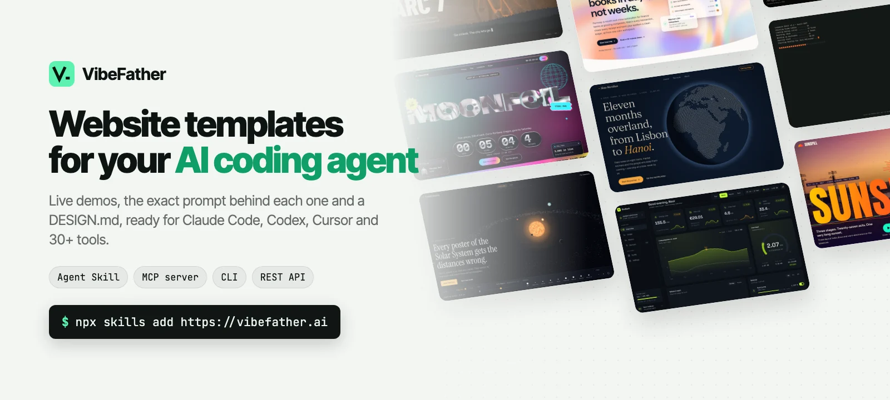
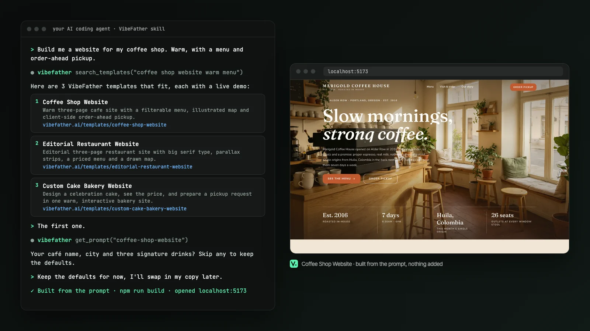
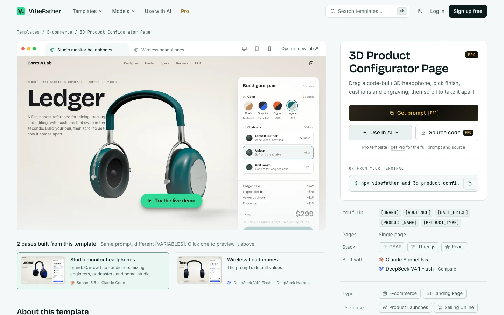
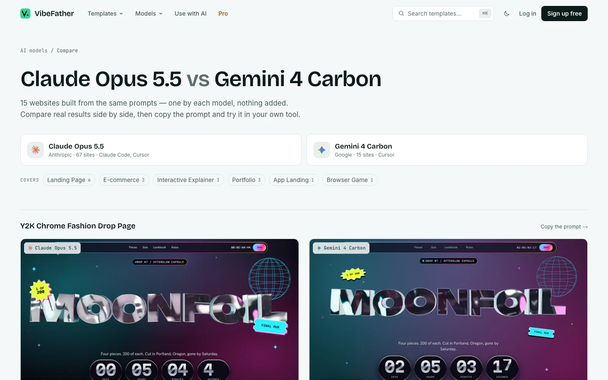
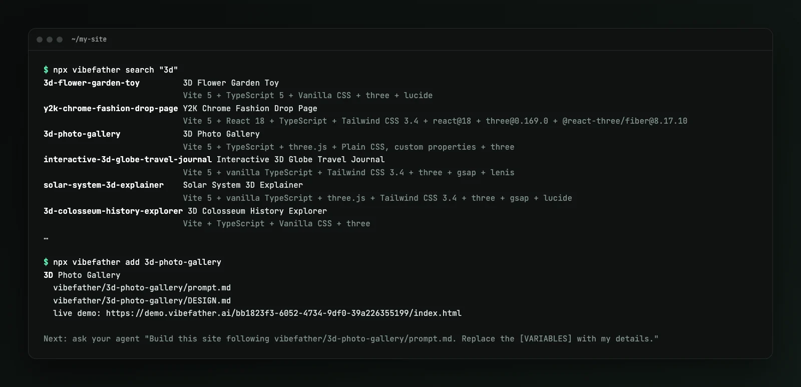
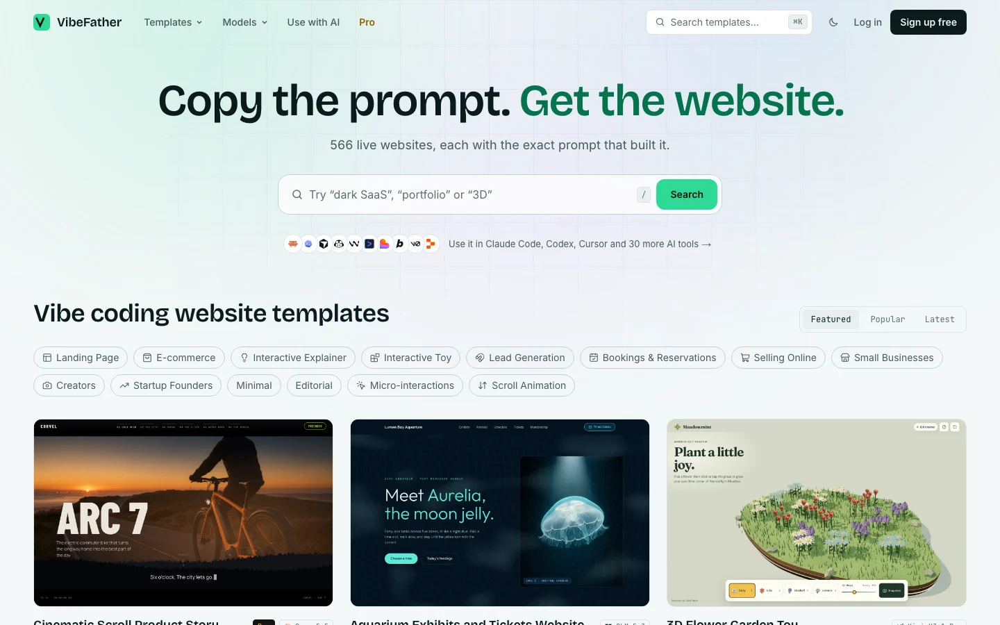
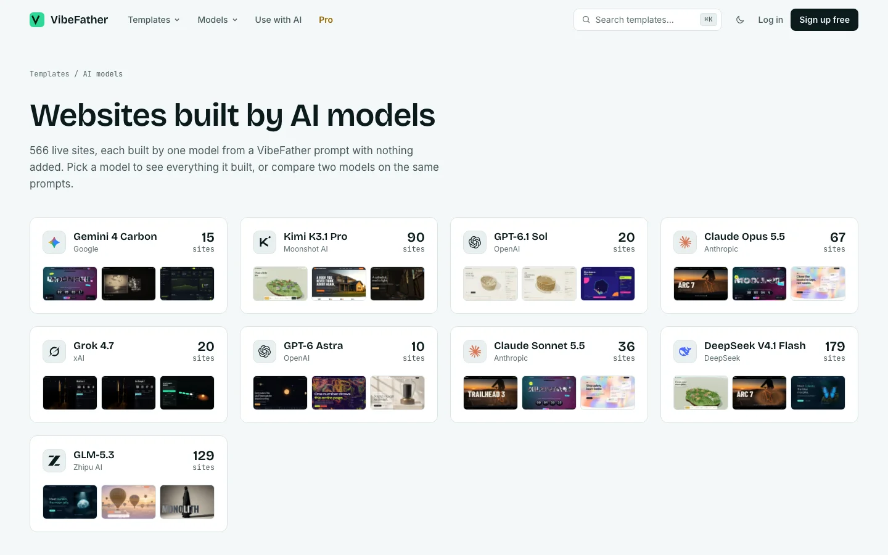
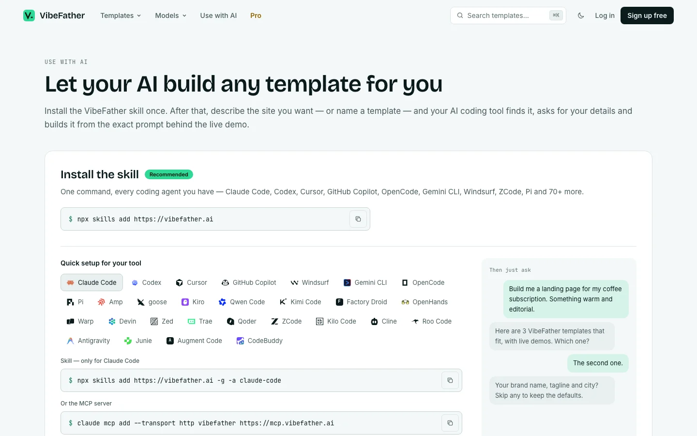

<!-- Generated by the VibeFather sync script. Edit the source, not this file. -->
<p align="center">
  <a href="https://vibefather.ai/?utm_source=github&utm_medium=readme&utm_campaign=vibefather&utm_content=hero">
    <picture>
      <source media="(prefers-color-scheme: dark)" srcset="assets/hero-dark.webp">
      
    </picture>
  </a>
</p>

<h1 align="center">VibeFather</h1>

<p align="center">
  <b>给 AI 编程 Agent 用的 vibe coding 网站模板库：Agent Skill + 远程 MCP 服务 + CLI。</b><br>
  让 Claude Code、Codex、Cursor、GitHub Copilot、Gemini CLI 直接调用 270+ 个原创网站模板，每个都有在线 Demo。<br>
  说一句想做什么网站，AI 自己挑模板、一次问清你的信息，再按 Demo 背后的原版提示词做出同款。
</p>

<p align="center">
  <a href="https://vibefather.ai/?utm_source=github&utm_medium=readme&utm_campaign=vibefather&utm_content=badge"></a>
  <a href="https://vibefather.ai/templates?utm_source=github&utm_medium=readme&utm_campaign=vibefather&utm_content=badge"></a>
  <a href="https://vibefather.ai/templates?utm_source=github&utm_medium=readme&utm_campaign=vibefather&utm_content=badge"></a>
  <a href="https://vibefather.ai/models?utm_source=github&utm_medium=readme&utm_campaign=vibefather&utm_content=badge"></a>
  <a href="#mcp-服务"></a>
  <a href="#agent-skill"></a>
  <a href="https://www.npmjs.com/package/vibefather"></a>
  <a href="LICENSE"></a>
</p>

<p align="center">
  <a href="https://vibefather.ai/?utm_source=github&utm_medium=readme&utm_campaign=vibefather&utm_content=top-cta"><b>▶ 在线浏览 560+ 个 Demo</b></a> &nbsp;·&nbsp;
  <a href="#快速开始">快速开始</a> &nbsp;·&nbsp;
  <a href="#mcp-服务">MCP 服务</a> &nbsp;·&nbsp;
  <a href="#cli">CLI</a> &nbsp;·&nbsp;
  <a href="README.md">English</a>
</p>

**VibeFather** 是一个专为 AI 编程工具打造的原创 **vibe coding 网站模板库**。每个模板都配有在线 Demo、生成这个 Demo 用的原版提示词（`prompt.md`，你的内容写成 `[变量]`）和一份独立的设计系统（`DESIGN.md`）。这个仓库放的是把整个模板库接进 AI 编程工具的开源组件：**VibeFather Agent Skill**、**远程 MCP 服务**的描述文件，以及命令行工具 **`vibefather` CLI**。

跟 AI 说一句"帮我的咖啡店做个网站，温暖一点，要有菜单和到店自取下单"，它会去模板库里搜索，给你看 2–4 个带在线 Demo 的模板；你选好以后，它一次性问清店名等信息，再用和 Demo 一样的技术栈、布局、配色、字体和动效把网站做出来。落地页、SaaS 官网、作品集、电商网站、数据看板、文档站、交互式讲解、3D 场景、网页小游戏都能做，技术栈覆盖 React、Tailwind CSS、Three.js、GSAP、Motion 和纯 HTML。Demo 由 9 个 AI 大模型生成（Claude、GPT、Gemini、Grok、Kimi、GLM、DeepSeek），同一份前端提示词在不同模型手里的效果也能直接对比。

<p align="center">
  
</p>

## 目录

- [为什么用 VibeFather](#为什么用-vibefather)
- [快速开始](#快速开始)
- [一个模板里有什么](#一个模板里有什么)
- [模板展示](#模板展示)
- [同一份提示词，不同的 AI 模型](#同一份提示词不同的-ai-模型)
- [MCP 服务](#mcp-服务)
- [Agent Skill](#agent-skill)
- [CLI](#cli)
- [REST API 和纯文本提示词](#rest-api-和纯文本提示词)
- [支持的 AI 编程工具](#支持的-ai-编程工具)
- [网站截图](#网站截图)
- [常见问题](#常见问题)

## 为什么用 VibeFather

- **验证过的提示词，不是提示词灵感。** 每个在线 Demo 都是严格按公开的 `prompt.md` 生成的，没有手工加料。照着提示词做，就能得到几乎一样的网站，只是换成你自己的文案、图片和品牌。
- **让 AI 自己逛模板库。** 装好 Skill 或接上 MCP，Claude Code、Codex、Cursor 就能按类型、风格、动效、技术栈、行业搜索 270+ 个模板，打开 Demo、读提示词、直接开做，不用在浏览器和编辑器之间来回复制粘贴。
- **可复用的设计系统。** 每个模板都带 `DESIGN.md`：颜色变量、字号层级、间距、组件和动效规则。可以只把它套到你现有的项目上，之后每次改动都保持同一套风格。
- **真实的前端技术栈。** Vite、React、TypeScript、Tailwind CSS、Three.js、GSAP、Motion、Lenis 和纯 HTML/CSS。每个 Demo 都是静态网站，上线前都在桌面端和手机端检查过。
- **全部原创。** 所有模板和 Demo 都是用我们自己的提示词由 AI 生成的。每个模板页都注明灵感来源，图片是 AI 生成或开放授权的素材，只用开源字体和开源组件。
- **零安装、不用 Key。** MCP 是远程服务（Streamable HTTP），免费调用；Skill 只是一个 Markdown 文件；CLI 没有任何依赖。

## 快速开始

**1. 安装 Skill（推荐）。** 一条命令把 VibeFather Skill 装进 Claude Code、Codex、Cursor、GitHub Copilot、Gemini CLI、OpenCode、Windsurf 等 70 多个支持 [Agent Skills](#agent-skill) 的工具：

```bash
npx skills add https://vibefather.ai
```

**2. 或者接入 MCP 服务。** 地址是 `https://mcp.vibefather.ai`（Streamable HTTP，不需要 API Key）。

<p>
  <a href="https://cursor.com/install-mcp?name=vibefather&config=eyJ1cmwiOiJodHRwczovL21jcC52aWJlZmF0aGVyLmFpIn0="></a>
  <a href="https://insiders.vscode.dev/redirect/mcp/install?name=vibefather&config=%7B%22type%22%3A%22http%22%2C%22url%22%3A%22https%3A%2F%2Fmcp.vibefather.ai%22%7D"></a>
  <a href="https://kiro.dev/launch/mcp/add?name=vibefather&config=%7B%22url%22%3A%22https%3A%2F%2Fmcp.vibefather.ai%22%2C%22disabled%22%3Afalse%2C%22autoApprove%22%3A%5B%5D%7D"></a>
</p>

**Claude Code**

```bash
claude mcp add --transport http vibefather https://mcp.vibefather.ai
```

**Codex**

```bash
codex mcp add vibefather --url https://mcp.vibefather.ai
```

**Gemini CLI**

```bash
gemini mcp add --transport http vibefather https://mcp.vibefather.ai
```

**Cursor**（`.cursor/mcp.json` 或 `~/.cursor/mcp.json`）

```json
{ "mcpServers": { "vibefather": { "url": "https://mcp.vibefather.ai" } } }
```

**VS Code / GitHub Copilot**（`.vscode/mcp.json`）

```json
{ "servers": { "vibefather": { "type": "http", "url": "https://mcp.vibefather.ai" } } }
```

**Windsurf**（`~/.codeium/windsurf/mcp_config.json`）

```json
{ "mcpServers": { "vibefather": { "serverUrl": "https://mcp.vibefather.ai" } } }
```

**Claude 桌面端 / claude.ai**：设置 → Connectors → Add custom connector → `https://mcp.vibefather.ai`
**ChatGPT**：设置 → Apps & Connectors → Advanced → 打开开发者模式，再用 `https://mcp.vibefather.ai` 新建 Connector

其他支持远程 MCP 的客户端（Trae、Qoder、Kimi Code、Qwen Code、Cherry Studio 等）填同一个地址即可。30 多个工具的分步接入说明：[docs/agents.md](docs/agents.md) 和 [vibefather.ai/ai](https://vibefather.ai/ai?utm_source=github&utm_medium=readme&utm_campaign=vibefather&utm_content=quick-start)。

**3. 然后直接说：**

> 用 VibeFather 的模板帮我做一个个人作品集网站。
>
> 在 VibeFather 上找一个暗色的 SaaS 落地页模板，按我的产品做出来。
>
> 用 `neo-brutalist-blog-and-portfolio` 的设计重新改一下这个项目的样式。

**不想配置 Agent？** 用 CLI 把一个模板放进任意项目：

```bash
npx vibefather add interactive-science-explainer
# 然后跟 AI 说："按 vibefather/interactive-science-explainer/prompt.md 做这个网站"
```

## 一个模板里有什么

<p align="center">
  <a href="https://vibefather.ai/templates/3d-product-configurator-page?utm_source=github&utm_medium=readme&utm_campaign=vibefather&utm_content=template-shot"></a>
</p>

| 文件 | 内容 |
|---|---|
| `prompt.md` | 完整的建站提示词：技术栈、文件结构、页面、区块、写成 `[变量]` 的文案、配色、字体、间距、动效、素材和验收标准。就是生成在线 Demo 的那一份。 |
| `DESIGN.md` | 单独的设计系统：颜色变量、字体排版、间距、圆角、组件、动效和该做 / 不该做的规则，适合给现有项目换皮。 |
| 在线 Demo | 用同一份提示词做出的一个或多个网站，每个都标明生成它的 AI 模型和工具，桌面端、手机端都能预览。 |
| 来源说明 | 模板的灵感来源作品、素材授权和生成模型。 |

## 模板展示

下面是 270+ 个模板中的一部分，每张图都是 AI 编程工具按提示词真实做出来的 Demo。全部模板在 [vibefather.ai/templates](https://vibefather.ai/templates?utm_source=github&utm_medium=readme&utm_campaign=vibefather&utm_content=gallery)，所有提示词的 Markdown 版在 [awesome-vibe-coding-websites](https://github.com/liyupi/awesome-vibe-coding-websites)（带中文参考译文）。

<table>
<tr>
<td width="33%" valign="top">
<a href="https://vibefather.ai/templates/cinematic-scroll-product-story?utm_source=github&utm_medium=readme&utm_campaign=vibefather&utm_content=gallery"></a><br>
<b><a href="https://vibefather.ai/templates/cinematic-scroll-product-story?utm_source=github&utm_medium=readme&utm_campaign=vibefather&utm_content=gallery">Cinematic Scroll Product Story</a></b><br>
<sub>A film-style scroll story for a hardware launch: pinned scenes, typed captions, counting specs and preorder.</sub><br>
<sub>Claude Opus 5.5 · Claude Sonnet 5.5 · DeepSeek V4.1 Flash · <a href="https://vibefather.ai/templates/cinematic-scroll-product-story?utm_source=github&utm_medium=readme&utm_campaign=vibefather&utm_content=gallery">在线 Demo</a> · <a href="https://github.com/liyupi/awesome-vibe-coding-websites/blob/main/templates/cinematic-scroll-product-story/prompt.zh-CN.md">提示词</a></sub>
</td>
<td width="33%" valign="top">
<a href="https://vibefather.ai/templates/webgl-gradient-saas-landing-page?utm_source=github&utm_medium=readme&utm_campaign=vibefather&utm_content=gallery"></a><br>
<b><a href="https://vibefather.ai/templates/webgl-gradient-saas-landing-page?utm_source=github&utm_medium=readme&utm_campaign=vibefather&utm_content=gallery">WebGL Gradient SaaS Landing Page</a></b><br>
<sub>Bright SaaS landing page with a cursor-reactive WebGL gradient hero and floating code-drawn product panels.</sub><br>
<sub>Claude Opus 5.5 · Claude Sonnet 5.5 · DeepSeek V4.1 Flash · <a href="https://vibefather.ai/templates/webgl-gradient-saas-landing-page?utm_source=github&utm_medium=readme&utm_campaign=vibefather&utm_content=gallery">在线 Demo</a> · <a href="https://github.com/liyupi/awesome-vibe-coding-websites/blob/main/templates/webgl-gradient-saas-landing-page/prompt.zh-CN.md">提示词</a></sub>
</td>
<td width="33%" valign="top">
<a href="https://vibefather.ai/templates/3d-photo-gallery?utm_source=github&utm_medium=readme&utm_campaign=vibefather&utm_content=gallery"></a><br>
<b><a href="https://vibefather.ai/templates/3d-photo-gallery?utm_source=github&utm_medium=readme&utm_campaign=vibefather&utm_content=gallery">3D Photo Gallery</a></b><br>
<sub>An endless 3D corridor of framed photographs you walk through, with rooms, a lightbox and full credits.</sub><br>
<sub>Claude Opus 5.5 · Claude Sonnet 5.5 · Gemini 4 Carbon · <a href="https://vibefather.ai/templates/3d-photo-gallery?utm_source=github&utm_medium=readme&utm_campaign=vibefather&utm_content=gallery">在线 Demo</a> · <a href="https://github.com/liyupi/awesome-vibe-coding-websites/blob/main/templates/3d-photo-gallery/prompt.zh-CN.md">提示词</a></sub>
</td>
</tr>
<tr>
<td width="33%" valign="top">
<a href="https://vibefather.ai/templates/y2k-chrome-fashion-drop-page?utm_source=github&utm_medium=readme&utm_campaign=vibefather&utm_content=gallery"></a><br>
<b><a href="https://vibefather.ai/templates/y2k-chrome-fashion-drop-page?utm_source=github&utm_medium=readme&utm_campaign=vibefather&utm_content=gallery">Y2K Chrome Fashion Drop Page</a></b><br>
<sub>A limited clothing drop page with a liquid-metal 3D wordmark, live countdown and sticker-slapped products.</sub><br>
<sub>Claude Opus 5.5 · Claude Sonnet 5.5 · Gemini 4 Carbon · <a href="https://vibefather.ai/templates/y2k-chrome-fashion-drop-page?utm_source=github&utm_medium=readme&utm_campaign=vibefather&utm_content=gallery">在线 Demo</a> · <a href="https://github.com/liyupi/awesome-vibe-coding-websites/blob/main/templates/y2k-chrome-fashion-drop-page/prompt.zh-CN.md">提示词</a></sub>
</td>
<td width="33%" valign="top">
<a href="https://vibefather.ai/templates/interactive-3d-globe-travel-journal?utm_source=github&utm_medium=readme&utm_campaign=vibefather&utm_content=gallery"></a><br>
<b><a href="https://vibefather.ai/templates/interactive-3d-globe-travel-journal?utm_source=github&utm_medium=readme&utm_campaign=vibefather&utm_content=gallery">Interactive 3D Globe Travel Journal</a></b><br>
<sub>A travel writer's journal where routes arc across a dotted 3D globe as readers scroll from stop to stop.</sub><br>
<sub>Claude Opus 5.5 · Claude Sonnet 5.5 · DeepSeek V4.1 Flash · <a href="https://vibefather.ai/templates/interactive-3d-globe-travel-journal?utm_source=github&utm_medium=readme&utm_campaign=vibefather&utm_content=gallery">在线 Demo</a> · <a href="https://github.com/liyupi/awesome-vibe-coding-websites/blob/main/templates/interactive-3d-globe-travel-journal/prompt.zh-CN.md">提示词</a></sub>
</td>
<td width="33%" valign="top">
<a href="https://vibefather.ai/templates/retro-desktop-os-portfolio?utm_source=github&utm_medium=readme&utm_campaign=vibefather&utm_content=gallery"></a><br>
<b><a href="https://vibefather.ai/templates/retro-desktop-os-portfolio?utm_source=github&utm_medium=readme&utm_campaign=vibefather&utm_content=gallery">Retro Desktop OS Portfolio</a></b><br>
<sub>A fictional 90s-style desktop OS portfolio with draggable windows, a start menu and looping motion previews.</sub><br>
<sub>Claude Opus 5.5 · Gemini 4 Carbon · GPT-6 Astra · <a href="https://vibefather.ai/templates/retro-desktop-os-portfolio?utm_source=github&utm_medium=readme&utm_campaign=vibefather&utm_content=gallery">在线 Demo</a> · <a href="https://github.com/liyupi/awesome-vibe-coding-websites/blob/main/templates/retro-desktop-os-portfolio/prompt.zh-CN.md">提示词</a></sub>
</td>
</tr>
<tr>
<td width="33%" valign="top">
<a href="https://vibefather.ai/templates/solar-system-3d-explainer?utm_source=github&utm_medium=readme&utm_campaign=vibefather&utm_content=gallery"></a><br>
<b><a href="https://vibefather.ai/templates/solar-system-3d-explainer?utm_source=github&utm_medium=readme&utm_campaign=vibefather&utm_content=gallery">Solar System 3D Explainer</a></b><br>
<sub>Fly through a 3D solar system, flip to true scale and watch the planets vanish into the dark.</sub><br>
<sub>Claude Opus 5.5 · Claude Sonnet 5.5 · Gemini 4 Carbon · GPT-6 Astra · <a href="https://vibefather.ai/templates/solar-system-3d-explainer?utm_source=github&utm_medium=readme&utm_campaign=vibefather&utm_content=gallery">在线 Demo</a> · <a href="https://github.com/liyupi/awesome-vibe-coding-websites/blob/main/templates/solar-system-3d-explainer/prompt.zh-CN.md">提示词</a></sub>
</td>
<td width="33%" valign="top">
<a href="https://vibefather.ai/templates/home-energy-dashboard?utm_source=github&utm_medium=readme&utm_campaign=vibefather&utm_content=gallery"></a><br>
<b><a href="https://vibefather.ai/templates/home-energy-dashboard?utm_source=github&utm_medium=readme&utm_campaign=vibefather&utm_content=gallery">Home Energy Dashboard</a></b><br>
<sub>A dark home-energy dashboard with hand-built SVG charts, a range switcher and live device toggles.</sub><br>
<sub>Claude Opus 5.5 · Gemini 4 Carbon · <a href="https://vibefather.ai/templates/home-energy-dashboard?utm_source=github&utm_medium=readme&utm_campaign=vibefather&utm_content=gallery">在线 Demo</a> · <a href="https://github.com/liyupi/awesome-vibe-coding-websites/blob/main/templates/home-energy-dashboard/prompt.zh-CN.md">提示词</a></sub>
</td>
<td width="33%" valign="top">
<a href="https://vibefather.ai/templates/music-festival-website?utm_source=github&utm_medium=readme&utm_campaign=vibefather&utm_content=gallery"></a><br>
<b><a href="https://vibefather.ai/templates/music-festival-website?utm_source=github&utm_medium=readme&utm_campaign=vibefather&utm_content=gallery">Music Festival Website</a></b><br>
<sub>A three-page festival site with a sound-reactive hero, filterable line-up, illustrated map and ticket table.</sub><br>
<sub>Claude Opus 5.5 · Claude Sonnet 5.5 · Gemini 4 Carbon · <a href="https://vibefather.ai/templates/music-festival-website?utm_source=github&utm_medium=readme&utm_campaign=vibefather&utm_content=gallery">在线 Demo</a> · <a href="https://github.com/liyupi/awesome-vibe-coding-websites/blob/main/templates/music-festival-website/prompt.zh-CN.md">提示词</a></sub>
</td>
</tr>
<tr>
<td width="33%" valign="top">
<a href="https://vibefather.ai/templates/aquarium-exhibits-and-tickets-website?utm_source=github&utm_medium=readme&utm_campaign=vibefather&utm_content=gallery"></a><br>
<b><a href="https://vibefather.ai/templates/aquarium-exhibits-and-tickets-website?utm_source=github&utm_medium=readme&utm_campaign=vibefather&utm_content=gallery">Aquarium Exhibits and Tickets Website</a></b><br>
<sub>A deep-blue aquarium site with drifting caustic light, zone exhibits, a feeding schedule and timed tickets.</sub><br>
<sub>GLM-5.3 · DeepSeek V4.1 Flash · <a href="https://vibefather.ai/templates/aquarium-exhibits-and-tickets-website?utm_source=github&utm_medium=readme&utm_campaign=vibefather&utm_content=gallery">在线 Demo</a> · <a href="https://github.com/liyupi/awesome-vibe-coding-websites/blob/main/templates/aquarium-exhibits-and-tickets-website/prompt.zh-CN.md">提示词</a></sub>
</td>
<td width="33%" valign="top">
<a href="https://vibefather.ai/templates/3d-flower-garden-toy?utm_source=github&utm_medium=readme&utm_campaign=vibefather&utm_content=gallery"></a><br>
<b><a href="https://vibefather.ai/templates/3d-flower-garden-toy?utm_source=github&utm_medium=readme&utm_campaign=vibefather&utm_content=gallery">3D Flower Garden Toy</a></b><br>
<sub>Plant a living 3D meadow, tune the wind, and save your garden as a snapshot.</sub><br>
<sub>Kimi K3.1 Pro · DeepSeek V4.1 Flash · <a href="https://vibefather.ai/templates/3d-flower-garden-toy?utm_source=github&utm_medium=readme&utm_campaign=vibefather&utm_content=gallery">在线 Demo</a> · <a href="https://github.com/liyupi/awesome-vibe-coding-websites/blob/main/templates/3d-flower-garden-toy/prompt.zh-CN.md">提示词</a></sub>
</td>
<td width="33%" valign="top">
<a href="https://vibefather.ai/templates/harbor-town-delivery-game?utm_source=github&utm_medium=readme&utm_campaign=vibefather&utm_content=gallery"></a><br>
<b><a href="https://vibefather.ai/templates/harbor-town-delivery-game?utm_source=github&utm_medium=readme&utm_campaign=vibefather&utm_content=gallery">Harbor Town Delivery Game</a></b><br>
<sub>Drive a tiny van, follow the tram lines, and finish six cozy harbor deliveries before time runs out.</sub><br>
<sub>Kimi K3.1 Pro · DeepSeek V4.1 Flash · <a href="https://vibefather.ai/templates/harbor-town-delivery-game?utm_source=github&utm_medium=readme&utm_campaign=vibefather&utm_content=gallery">在线 Demo</a> · <a href="https://github.com/liyupi/awesome-vibe-coding-websites/blob/main/templates/harbor-town-delivery-game/prompt.zh-CN.md">提示词</a></sub>
</td>
</tr>
</table>

**按类型浏览：** [落地页模板](https://vibefather.ai/tags/landing-page?utm_source=github&utm_medium=readme&utm_campaign=vibefather&utm_content=categories) · [SaaS 官网模板](https://vibefather.ai/tags/saas?utm_source=github&utm_medium=readme&utm_campaign=vibefather&utm_content=categories) · [作品集模板](https://vibefather.ai/tags/portfolio?utm_source=github&utm_medium=readme&utm_campaign=vibefather&utm_content=categories) · [电商网站模板](https://vibefather.ai/tags/ecommerce?utm_source=github&utm_medium=readme&utm_campaign=vibefather&utm_content=categories) · [数据看板模板](https://vibefather.ai/tags/dashboard?utm_source=github&utm_medium=readme&utm_campaign=vibefather&utm_content=categories) · [文档站](https://vibefather.ai/tags/docs?utm_source=github&utm_medium=readme&utm_campaign=vibefather&utm_content=categories) · [交互式讲解](https://vibefather.ai/tags/explainer?utm_source=github&utm_medium=readme&utm_campaign=vibefather&utm_content=categories) · [网页幻灯片](https://vibefather.ai/tags/slides?utm_source=github&utm_medium=readme&utm_campaign=vibefather&utm_content=categories) · [3D 网站](https://vibefather.ai/tags/3d?utm_source=github&utm_medium=readme&utm_campaign=vibefather&utm_content=categories) · [网页小游戏](https://vibefather.ai/tags/game?utm_source=github&utm_medium=readme&utm_campaign=vibefather&utm_content=categories) · [网页玩具](https://vibefather.ai/tags/toy?utm_source=github&utm_medium=readme&utm_campaign=vibefather&utm_content=categories) · [小商家官网](https://vibefather.ai/tags/small-business?utm_source=github&utm_medium=readme&utm_campaign=vibefather&utm_content=categories) · [餐厅网站](https://vibefather.ai/tags/restaurant?utm_source=github&utm_medium=readme&utm_campaign=vibefather&utm_content=categories) · [候补名单页](https://vibefather.ai/tags/waitlist?utm_source=github&utm_medium=readme&utm_campaign=vibefather&utm_content=categories)

## 同一份提示词，不同的 AI 模型

很多模板有两个以上模型用完全相同的提示词做出的 Demo，可以并排比较 Claude、GPT、Gemini、Grok、Kimi、GLM、DeepSeek 在真实前端任务上的表现。同一个模板一凑齐两个模型的案例，对比页就会自动生成。

<p align="center">
  <a href="https://vibefather.ai/compare/claude-opus-5-5-vs-gemini-4-carbon?utm_source=github&utm_medium=readme&utm_campaign=vibefather&utm_content=compare-shot"></a>
</p>

每个模型做了哪些网站：[vibefather.ai/models](https://vibefather.ai/models?utm_source=github&utm_medium=readme&utm_campaign=vibefather&utm_content=compare)。

## MCP 服务

`https://mcp.vibefather.ai` 是无状态的远程 MCP 服务（Streamable HTTP），免费、不需要 API Key。接上以后，模型同时会拿到和 Skill 一样的使用说明，知道该怎么挑模板、问信息、开工。注册表描述文件见 [`server.json`](server.json)。

| 工具 | 作用 |
|---|---|
| `search_templates` | 按关键词和标签（`landing-page`、`dark`、`threejs`、`restaurant`…）搜索模板，返回 slug、名称、一句话介绍、标签、技术栈和页面链接。 |
| `get_template` | 单个模板的详情：介绍、技术栈、标签、灵感来源、每个在线 Demo 及生成它的模型、预览图。 |
| `get_prompt` | 完整的 `prompt.md`，严格照做并替换 `[变量]`。Pro 模板返回需求简介、技术栈和变量。 |
| `get_design_md` | 模板的 `DESIGN.md`，用来给现有项目换上这套设计。 |
| `list_tags` | 按维度（类型、用途、人群、风格、动效、技术栈、行业）分组的全部标签和数量。 |
| `get_source` | 怎样获取 Demo 的工程化源码（VibeFather Pro）。 |

| Prompt | 作用 |
|---|---|
| `build_website` | "用 VibeFather 帮我做一个网站：……"：搜索、给出带 Demo 链接的选项、一次问清变量、开做。在 Claude Code 里显示为斜杠命令。 |
| `apply_design` | 把某个模板的 `DESIGN.md` 套到当前项目上，保留你的内容和路由。 |

完整参考和调用示例：[docs/api.md](docs/api.md)。

## Agent Skill

[`skills/vibefather/SKILL.md`](skills/vibefather/SKILL.md) 是一个符合 [Agent Skills](https://agentskills.io) 规范的文件，教会任何编程 Agent 使用 VibeFather 的完整流程：搜索模板（MCP、`curl` 或 CLI，哪个能用就用哪个）、让你挑选、一次问清变量、严格按提示词构建、和在线 Demo 对比、遵守授权协议。

```bash
npx skills add https://vibefather.ai                      # 交互式选择要装到哪些 Agent
npx skills add https://vibefather.ai -g -a claude-code    # 或者只装一个：codex、cursor、gemini-cli、opencode…
npx skills add liyupi/vibefather                          # 从这个仓库装，内容相同
npx vibefather skill                                      # 或者用我们的 CLI（写入 ~/.agents/skills 和 ~/.claude/skills）
```

vibefather.ai 在 [`/.well-known/agent-skills/index.json`](https://vibefather.ai/.well-known/agent-skills/index.json) 发布了这个 Skill，所以给网站地址就够了。也可以手动安装：

```bash
# Claude Code：~/.claude/skills   Codex、Cursor、Copilot、Gemini CLI、Windsurf：~/.agents/skills
mkdir -p ~/.claude/skills/vibefather
curl -s https://vibefather.ai/skill.md -o ~/.claude/skills/vibefather/SKILL.md
```

## CLI

[npm 上的 `vibefather`](https://www.npmjs.com/package/vibefather)，源码在 [`cli/`](cli)。需要 Node 18+，零依赖。

<p align="center">
  
</p>

```bash
npx vibefather search "dark saas"                     # 搜索模板
npx vibefather add <slug>                             # 写入 vibefather/<slug>/prompt.md + DESIGN.md
npx vibefather add <slug> --design-only               # 只要设计系统
npx vibefather add <slug> --dir ./design              # 指定目录
npx vibefather open <slug>                            # 打开在线 Demo 页
npx vibefather skill [--project]                      # 安装 Agent Skill
npx vibefather mcp                                    # 打印各工具的 MCP 配置
```

然后跟 AI 说：*"按 vibefather/&lt;slug&gt;/prompt.md 做这个网站，把 [VARIABLES] 换成我的信息。"*

## REST API 和纯文本提示词

全部公开、只读、不需要 Key。

```bash
curl -s "https://vibefather.ai/api/v1/templates?q=portfolio&tags=dark&limit=5"   # 搜索（JSON）
curl -s https://vibefather.ai/api/v1/templates/3d-photo-gallery                   # 单个模板（JSON）
curl -s https://vibefather.ai/templates/3d-photo-gallery.md                       # 它的提示词（Markdown）
curl -s https://vibefather.ai/api/v1/templates/3d-photo-gallery/design            # 它的 DESIGN.md
```

给大模型和爬虫看的：[`llms.txt`](https://vibefather.ai/llms.txt)、[`llms-full.txt`](https://vibefather.ai/llms-full.txt)、[`skill.md`](https://vibefather.ai/skill.md)。全部接口和参数：[docs/api.md](docs/api.md)。

## 支持的 AI 编程工具

Skill、MCP 服务和提示词适用于任何能读长提示词、能写文件的 AI 编程工具。各工具的接入页：

**编程 Agent：** [Claude Code](https://vibefather.ai/ai/claude-code?utm_source=github&utm_medium=readme&utm_campaign=vibefather&utm_content=tools) · [Codex](https://vibefather.ai/ai/codex?utm_source=github&utm_medium=readme&utm_campaign=vibefather&utm_content=tools) · [Gemini CLI](https://vibefather.ai/ai/gemini-cli?utm_source=github&utm_medium=readme&utm_campaign=vibefather&utm_content=tools) · [OpenCode](https://vibefather.ai/ai/opencode?utm_source=github&utm_medium=readme&utm_campaign=vibefather&utm_content=tools) · [Pi](https://vibefather.ai/ai/pi?utm_source=github&utm_medium=readme&utm_campaign=vibefather&utm_content=tools) · [Amp](https://vibefather.ai/ai/amp?utm_source=github&utm_medium=readme&utm_campaign=vibefather&utm_content=tools) · [goose](https://vibefather.ai/ai/goose?utm_source=github&utm_medium=readme&utm_campaign=vibefather&utm_content=tools) · [Kiro](https://vibefather.ai/ai/kiro-cli?utm_source=github&utm_medium=readme&utm_campaign=vibefather&utm_content=tools) · [Qwen Code](https://vibefather.ai/ai/qwen-code?utm_source=github&utm_medium=readme&utm_campaign=vibefather&utm_content=tools) · [Kimi Code](https://vibefather.ai/ai/kimi-code?utm_source=github&utm_medium=readme&utm_campaign=vibefather&utm_content=tools) · [DeepSeek Harness](https://vibefather.ai/ai/deepseek-harness?utm_source=github&utm_medium=readme&utm_campaign=vibefather&utm_content=tools) · [Factory Droid](https://vibefather.ai/ai/droid?utm_source=github&utm_medium=readme&utm_campaign=vibefather&utm_content=tools) · [OpenHands](https://vibefather.ai/ai/openhands?utm_source=github&utm_medium=readme&utm_campaign=vibefather&utm_content=tools) · [Warp](https://vibefather.ai/ai/warp?utm_source=github&utm_medium=readme&utm_campaign=vibefather&utm_content=tools) · [Devin](https://vibefather.ai/ai/devin?utm_source=github&utm_medium=readme&utm_campaign=vibefather&utm_content=tools)

**AI 编辑器：** [Cursor](https://vibefather.ai/ai/cursor?utm_source=github&utm_medium=readme&utm_campaign=vibefather&utm_content=tools) · [GitHub Copilot](https://vibefather.ai/ai/github-copilot?utm_source=github&utm_medium=readme&utm_campaign=vibefather&utm_content=tools) · [Windsurf](https://vibefather.ai/ai/windsurf?utm_source=github&utm_medium=readme&utm_campaign=vibefather&utm_content=tools) · [Zed](https://vibefather.ai/ai/zed?utm_source=github&utm_medium=readme&utm_campaign=vibefather&utm_content=tools) · [Trae](https://vibefather.ai/ai/trae?utm_source=github&utm_medium=readme&utm_campaign=vibefather&utm_content=tools) · [Qoder](https://vibefather.ai/ai/qoder?utm_source=github&utm_medium=readme&utm_campaign=vibefather&utm_content=tools) · [ZCode](https://vibefather.ai/ai/zcode?utm_source=github&utm_medium=readme&utm_campaign=vibefather&utm_content=tools) · [Kilo Code](https://vibefather.ai/ai/kilo-code?utm_source=github&utm_medium=readme&utm_campaign=vibefather&utm_content=tools) · [Cline](https://vibefather.ai/ai/cline?utm_source=github&utm_medium=readme&utm_campaign=vibefather&utm_content=tools) · [Roo Code](https://vibefather.ai/ai/roo-code?utm_source=github&utm_medium=readme&utm_campaign=vibefather&utm_content=tools) · [Antigravity](https://vibefather.ai/ai/antigravity?utm_source=github&utm_medium=readme&utm_campaign=vibefather&utm_content=tools) · [Junie](https://vibefather.ai/ai/junie?utm_source=github&utm_medium=readme&utm_campaign=vibefather&utm_content=tools) · [Augment Code](https://vibefather.ai/ai/augment?utm_source=github&utm_medium=readme&utm_campaign=vibefather&utm_content=tools) · [CodeBuddy](https://vibefather.ai/ai/codebuddy?utm_source=github&utm_medium=readme&utm_campaign=vibefather&utm_content=tools)

**浏览器里的 App 构建工具：** [Lovable](https://vibefather.ai/ai/lovable?utm_source=github&utm_medium=readme&utm_campaign=vibefather&utm_content=tools) · [Bolt](https://vibefather.ai/ai/bolt?utm_source=github&utm_medium=readme&utm_campaign=vibefather&utm_content=tools) · [v0](https://vibefather.ai/ai/v0?utm_source=github&utm_medium=readme&utm_campaign=vibefather&utm_content=tools) · [Replit](https://vibefather.ai/ai/replit?utm_source=github&utm_medium=readme&utm_campaign=vibefather&utm_content=tools)（直接粘贴提示词，这类工具不加载 Skill）

## 网站截图

AI 能看到的内容，在 [vibefather.ai](https://vibefather.ai/?utm_source=github&utm_medium=readme&utm_campaign=vibefather&utm_content=website) 上都能直接浏览：搜索、标签页、桌面端和手机端的在线 Demo、一键复制提示词、模型页和并排对比。

| 首页 | AI 模型 | 在 AI 里使用 |
|---|---|---|
| [](https://vibefather.ai/?utm_source=github&utm_medium=readme&utm_campaign=vibefather&utm_content=website) | [](https://vibefather.ai/models?utm_source=github&utm_medium=readme&utm_campaign=vibefather&utm_content=website) | [](https://vibefather.ai/ai?utm_source=github&utm_medium=readme&utm_campaign=vibefather&utm_content=website) |

## 常见问题

**什么是 vibe coding？** 用自然语言把需求告诉 AI 编程 Agent，让它来写代码的开发方式。VibeFather 给 AI 一个验证过的起点，让"帮我做个网站"变成一个具体、设计讲究的网站，而不是千篇一律的模板脸。

**免费吗？** Skill、MCP 服务、CLI 和 API 都免费。大部分提示词和全部 `DESIGN.md` 可免费用于个人和非商业项目（[CC BY-NC 4.0](https://creativecommons.org/licenses/by-nc/4.0/deed.zh-hans)，保留署名）。Pro 模板免费公开需求简介、技术栈和变量；完整提示词、Demo 的工程化源码和商用授权包含在 [VibeFather Pro](https://vibefather.ai/pricing?utm_source=github&utm_medium=readme&utm_campaign=vibefather&utm_content=faq) 里。

**可以给客户或公司做网站吗？** 商用需要 Pro 授权。个人网站、学习和非商业项目用免费授权即可。

**该用哪个 AI 模型？** 能力足够的编程模型都可以。每个 Demo 都标了生成它的模型，可以看看[模型页](https://vibefather.ai/models?utm_source=github&utm_medium=readme&utm_campaign=vibefather&utm_content=faq)和对比页，了解各模型处理同一份提示词的效果。

**做出来会和 Demo 一模一样吗？** 非常接近。每个 Demo 都严格按公开的提示词生成，没有额外加工；Skill 还会让 AI 把结果和 Demo 对比、修掉明显的差异。你的文案、图片和品牌通过 `[变量]` 替换默认内容。

**网站本身开源吗？** 不开源。这个仓库放的是接入组件（Agent Skill、MCP 描述文件和 CLI）；全部提示词以 Markdown 形式公开在 [awesome-vibe-coding-websites](https://github.com/liyupi/awesome-vibe-coding-websites)；网站和模板生成流程由 VibeFather 运营。

**发现问题或想要某类模板？** 提 [Issue](https://github.com/liyupi/vibefather/issues)，或发邮件到 hello@vibefather.ai。

## 相关项目

- [awesome-vibe-coding-websites](https://github.com/liyupi/awesome-vibe-coding-websites)：所有 VibeFather 模板的 Markdown 版，含提示词（带中文参考译文）、DESIGN.md、模型对比和在线 Demo 链接，每天自动同步。
- [vibefather.ai](https://vibefather.ai/?utm_source=github&utm_medium=readme&utm_campaign=vibefather&utm_content=related)：在线浏览和预览全部模板。

## 开源协议

本仓库的代码（CLI、Skill、描述文件）采用 [MIT](LICENSE) 协议。vibefather.ai 提供的模板提示词和 `DESIGN.md` 另有授权：免费模板为 CC BY-NC 4.0，商用请使用 [VibeFather Pro](https://vibefather.ai/pricing?utm_source=github&utm_medium=readme&utm_campaign=vibefather&utm_content=license)。

如果 VibeFather 让你的 AI 少做了一个千篇一律的落地页，点个 ⭐ 能帮更多开发者找到它。
